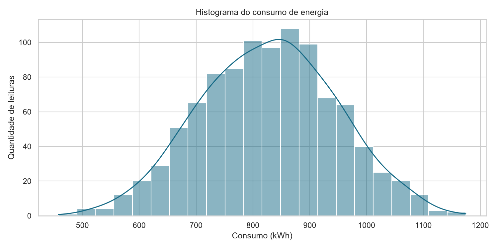
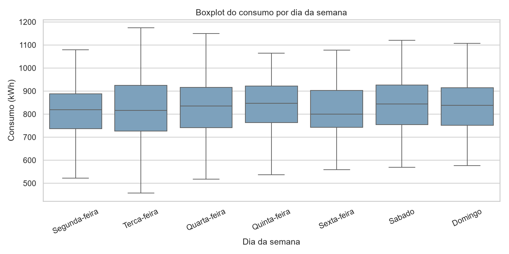
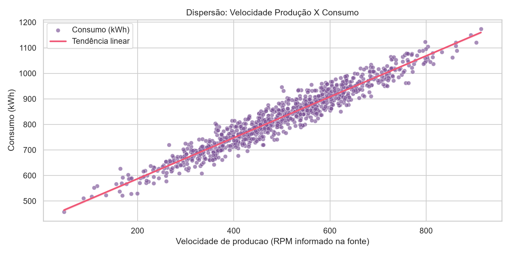
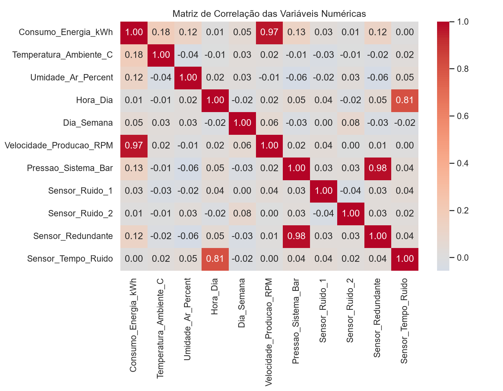
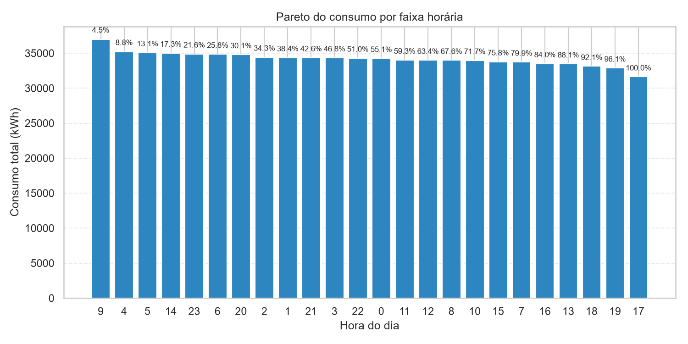
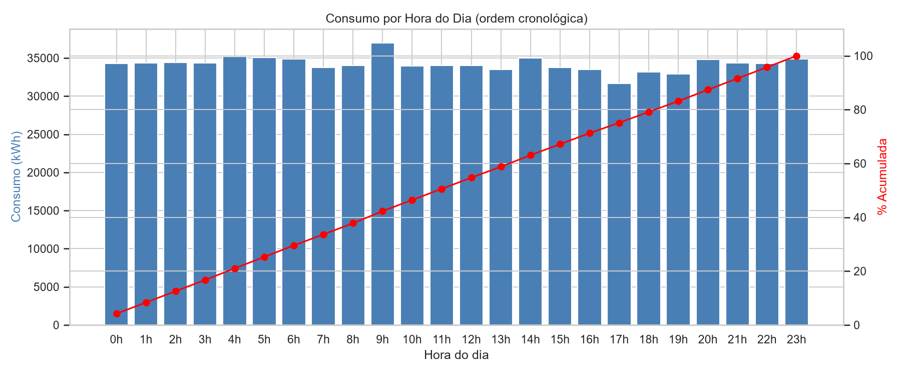
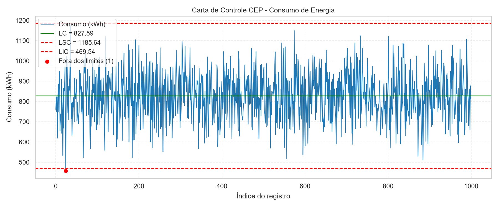
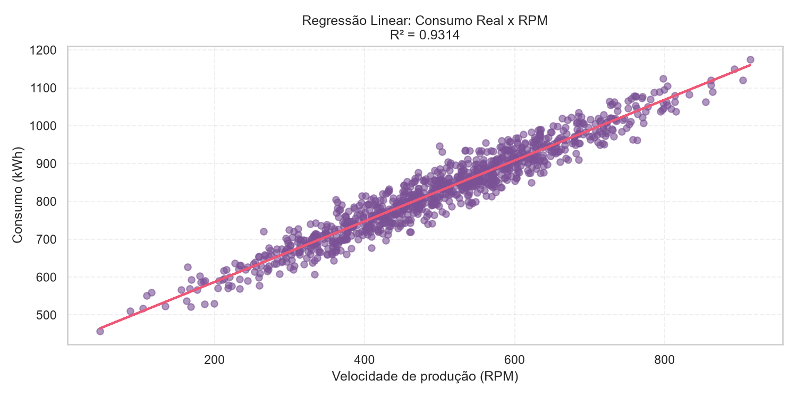
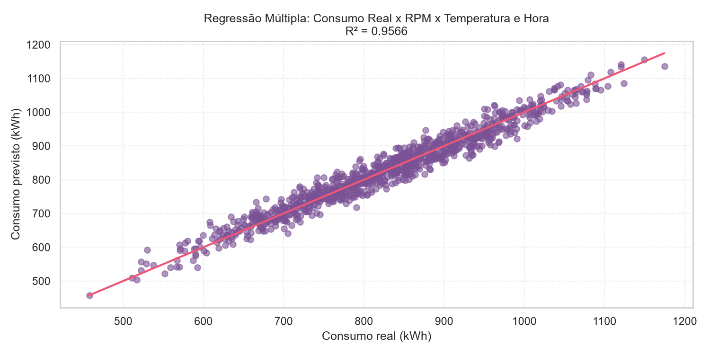

# Análise de Consumo de Energia

Projeto acadêmico de análise exploratória e auditoria da qualidade de dados de consumo de energia. O notebook trata os dados de uma planilha de sensores industriais, investiga padrões de consumo e estima oportunidades de economia.

## Resultados visuais

| Distribuição do consumo | Consumo por dia |
| --- | --- |
|  |  |
| Relação entre RPM e consumo | Correlação entre variáveis |
|  |  |
| Pareto do consumo por hora | Consumo por hora em ordem cronológica |
|  |  |
| Carta de controle | Regressão linear por RPM |
|  |  |

Regressão múltipla do consumo de energia:



## Funcionalidades

- Verificação e tratamento de dados ausentes, duplicados, tipos e valores fora do domínio esperado.
- Análise de consumo por horário e dia, com distribuições, correlações e diagramas de Pareto.
- Gráficos de controle e regressões para explorar a relação entre consumo e variáveis operacionais.
- Estimativas de economia potencial e retorno do investimento com base no período observado.
- Exportação de gráficos e materiais de análise para `resultados/`.

As estimativas são exploratórias: correlação e regressão não comprovam que uma ação causará economia. A validação exige medições comparáveis antes e depois da intervenção.

## Tecnologias

- Python e Jupyter Notebook
- pandas e NumPy para tratamento e análise dos dados
- Matplotlib e Seaborn para visualizações
- scikit-learn para regressão
- openpyxl para leitura da planilha Excel

## Dados

O notebook espera encontrar a planilha `dados/dados_consumo_energia.xlsx` na raiz do projeto. A planilha contém registros temporais de consumo, condições ambientais e variáveis de sensores. Antes de distribuir os dados publicamente, confirme a licença e a autorização da fonte.

## Como executar

1. Instale o Python e abra a raiz do projeto no VS Code.
2. Crie e ative um ambiente virtual:

   ```powershell
   py -m venv .venv
   .\.venv\Scripts\Activate.ps1
   ```

3. Instale as dependências:

   ```powershell
   python -m pip install -r requirements.txt
   ```

4. Abra `Analise.ipynb`, selecione o ambiente `.venv` como kernel e execute as células em ordem. Mantenha a pasta do projeto como diretório de trabalho para que os caminhos relativos encontrem os dados e salvem os resultados corretamente.

Os gráficos gerados são salvos em `resultados/`.

## Estrutura

```text
.
├── Analise.ipynb                  # Análise e visualizações
├── dados/
│   └── dados_consumo_energia.xlsx # Planilha de entrada
├── resultados/                    # Gráficos e apresentação exportados
├── requirements.txt               # Dependências Python
└── README.md
```

Materiais de aula e o notebook de apoio ao professor são arquivos auxiliares locais e ficam fora do controle de versão.

## Autoria e licença

Projeto de Kayky Crespo dos Santos. Consulte [LICENSE](LICENSE) para os termos da licença MIT. A licença do código não substitui a autorização necessária para redistribuir a planilha de dados ou materiais de terceiros.
